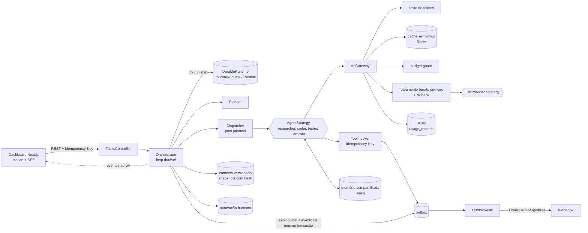

<div align="center">


# JP Orchestrator

**por JpDev**

Orquestrador open source de agentes de código: distribui tarefas entre subagentes em paralelo,
com AI Gateway, execução durável, memória compartilhada, contexto versionado e billing por tarefa.

NestJS · TypeScript · Postgres · Redis · Next.js · Motion · Docker Compose · MIT

</div>

---

## Português

### O que é

O JP Orchestrator recebe uma tarefa de engenharia ("criar endpoint REST com testes"), quebra em
subtarefas, roda subagentes especializados em paralelo (pesquisador, coder, tester, revisor),
consolida o resultado e publica um evento assinado quando termina. Cada chamada de modelo passa
por um AI Gateway que prioriza cache e modelos baratos, registra tokens e custo, e corta a tarefa
automaticamente quando o orçamento estoura.

Nesta versão os subagentes usam um provedor de modelo determinístico (`MockProvider`) com latência
configurável. A interface `LlmProvider` é uma Strategy: um provedor real entra como mais uma classe,
sem mexer no orquestrador.

O dashboard em Next.js mostra tudo ao vivo via SSE: subagentes rodando em paralelo, fluxo pelo
gateway (cache, modelo, fallback), custos animados, timeline do contexto versionado, aprovação
humana e webhooks recebidos com assinatura verificada.


### Arquitetura



### Patterns e onde estão no código

| Pattern | O que faz | Onde |
|---|---|---|
| AI Gateway | Ponto único das chamadas de modelo: limite de tokens, cache semântico, budget guard, roteamento pelo modelo mais barato do tier, fallback em queda | `api/src/gateway/gateway.service.ts`, `model-catalog.ts`, `semantic-cache.ts` |
| Strategy | Registro por eixo (`StrategyRegistry`), mesmo estilo do strategy-pattern-checkout: agentes, provedores de modelo e ferramentas | `api/src/strategy/strategy-registry.ts`, `agents/agents.ts`, `gateway/llm-provider.ts`, `tools/builtin-tools.ts` |
| Durable execution | Loop escrito como passos nomeados (`ctx.run`); passo concluído nunca roda de novo; retoma após crash ou pausa. Interface pronta para Restate | `api/src/durable/durable-runtime.ts`, `journal.runtime.ts`, `restate.runtime.ts` |
| Idempotency-Key + outbox | `POST /tasks` com `Idempotency-Key`; ferramentas executam uma vez por chave e gravam o evento na mesma transação do resultado | `api/src/tools/tool-invoker.service.ts`, `persistence/pg.store.ts` |
| Aprovação humana durável | Pausa gravada no Postgres; aprovar ou rejeitar retoma o loop pelo journal, mesmo após restart | `api/src/approval/approval.service.ts`, `orchestration/orchestrator.service.ts` |
| Eventos assinados | Webhook com `X-JP-Signature: t=..,v1=HMAC-SHA256`, tolerância de replay, retry com backoff, entrega pelo outbox | `api/src/events/signer.ts`, `outbox-relay.service.ts`, `events.module.ts` |
| Memória compartilhada | Blackboard por tarefa (hash Redis): pesquisador publica, coder e revisor leem | `api/src/memory/shared-memory.ts` |
| Contexto versionado | Snapshots append-only com versão e hash encadeado (`hash = sha256(parentHash + JSON canônico)`), verificação de adulteração | `api/src/memory/context-store.service.ts` |
| Billing e orçamento | Tokens e custo por tarefa, subagente e modelo; corte automático ao estourar; relatório CSV | `api/src/billing/billing.service.ts`, `scripts/` |

### Loops de orquestração

Todo loop é limitado. Nada repete "até passar". Limites configuráveis por variável de ambiente.

| Loop | Objetivo | Critério de saída | Timeout | Limite de chamadas |
|---|---|---|---|---|
| task | Levar a tarefa a um estado final | completed, failed, rejected ou budget_exceeded | `TASK_TIMEOUT_MS` (180 s) | 1 execução por vez por tarefa |
| plan | Quebrar a tarefa em subtarefas | pelo menos 1 subtarefa de trabalho e 1 revisor | `PLAN_TIMEOUT_MS` (15 s) | 1 chamada ao gateway (tier barato) |
| dispatch | Rodar subagentes de cada onda em paralelo (`MAX_PARALLEL`) | todas as subtarefas em done | `SUBAGENT_TIMEOUT_MS` (30 s) por subagente | 2 por subtarefa (1 retry) |
| correction | Revisor aprova ou devolve feedback; coders corrigem | revisão aprovada; falha após 2 rodadas | `REVIEW_TIMEOUT_MS` (30 s) | máximo 2 rodadas de correção |
| approval | Pausa durável até decisão humana | approved ou rejected | sem timeout (pausa persistida) | 0 chamadas de modelo |
| merge | Consolidar saídas e artefatos | resultado único sem duplicatas | `MERGE_TIMEOUT_MS` (10 s) | 0 chamadas de modelo |
| outbox | Entregar eventos assinados | 2xx, ou morto após `OUTBOX_MAX_ATTEMPTS` | `OUTBOX_TIMEOUT_MS` (5 s) por entrega | 5 tentativas, backoff 2^n s |

Ondas do dispatch: pesquisadores primeiro (alimentam a memória compartilhada), depois coders e
testers em paralelo, depois o revisor.

### Economia de tokens

- Cache semântico antes de qualquer chamada: prompt parecido (cosseno >= `CACHE_SIMILARITY`) custa zero e registra a economia.
- Roteamento pelo modelo mais barato do tier pedido; tiers mais caros só como fallback.
- Limite de tokens de entrada e saída antes de gastar.
- Budget guard por tarefa: a chamada que cruzaria o orçamento é bloqueada e a tarefa vai para `budget_exceeded`.
- Embedding local (hash de palavras e bigramas): a consulta ao cache não chama modelo.

### Como rodar

Pré-requisitos: Docker com Compose, Node 22.

```bash
docker compose up -d --build        # postgres, redis, api (:3001), web (:3000)
open http://localhost:3000

npm run loop:run                    # dispara um loop real e mostra o pico de subagentes em paralelo
npm run billing:report              # relatório de consumo em reports/billing-AAAA-MM-DD.md
npm run budget:check -- --warn 0.8  # sai com código 1 se alguma tarefa passou de 80% do orçamento
```

Desenvolvimento local:

```bash
npm run install:all
npm test                            # testes unitários (jest) da API
npm run prepush                     # lint + typecheck + build + testes
npx playwright install chromium && npm run e2e   # e2e contra o stack rodando
```

Sem `DATABASE_URL` e `REDIS_URL` a API roda inteira em memória. Variáveis em `.env.example`.
Contrato da API em `docs/api-contract.md`. Screenshots do e2e em `docs/screenshots/`.

### Vídeos de demonstração

Gravados com Playwright sobre a stack real (`docker compose up`), sem mocks, e montados com ffmpeg:
`docs/marketing/tiktok-instagram-9x16.mp4`, `docs/marketing/linkedin-1x1.mp4` e `docs/marketing/linkedin-16x9.mp4`.

```bash
node scripts/marketing/record.mjs desktop reports/marketing   # 1600x900, com marcadores de tempo
node scripts/marketing/record.mjs mobile reports/marketing    # 720x1280
node scripts/marketing/build-videos.mjs reports/marketing docs/marketing
```

O ffmpeg do Homebrew não tem `drawtext` nem `libass`: legendas e cartões da marca são PNG renderizados pelo Playwright e aplicados com `overlay`.

### Identidade visual (JpDev)

| Token | Valor | Uso |
|---|---|---|
| `brand` | `#FFC800` | CTA principal, destaques, foco visível, rótulos de seção |
| `brand-soft` | `#FACC15` | hover do CTA, status "Planejando" |
| `ink` | `#0A0A0A` | fundo e texto sobre amarelo (contraste 12,7:1 com o amarelo) |
| `accent` | `#FF7A00` | apoio: aguardando aprovação, integrando, barras por agente |
| `ok` / `bad` | `#5FBF85` / `#F07171` | só status semântico (sucesso / falha) |

Tipografia: Space Grotesk (títulos, via `next/font`) e Inter (texto). O logo é `brand/jpdev-logo.png`,
apenas redimensionado para o topbar (`web/public/jpdev-logo.png`), favicon (`web/app/icon.png`, `apple-icon.png`),
este README e os vídeos. Os vídeos carregam as fontes do Google Fonts no render e o build falha se elas não carregarem.

### Inspiração

O desenho de portões, loops limitados e "teste verde manda" é inspirado conceitualmente no
[VJP Harness](https://github.com/Joao-Pedro-AI-Visionary/vjp-harness). Não há dependência de código.

---

## English

### What it is

JP Orchestrator is an open source orchestrator for coding agents. It splits an engineering task into
subtasks, runs specialized subagents in parallel (researcher, coder, tester, reviewer), merges their
output and emits an HMAC-signed event when done. Every model call goes through an AI Gateway with
token limits, a semantic cache, cheapest-first routing, model fallback and a per-task budget with an
automatic cut. The agent loop is durable (journaled steps, Restate-ready interface), tool calls are
idempotent with a transactional outbox, human approval is a durable pause, subagents share a per-task
memory and the task context is versioned as hash-chained snapshots. A Next.js dashboard shows it all
live over SSE.

This version ships a deterministic `MockProvider`; real providers plug in as another `LlmProvider` strategy.

### Run it

```bash
docker compose up -d --build   # http://localhost:3000 (UI), http://localhost:3001 (API)
npm run loop:run               # real orchestration loop with parallel subagents
npm run billing:report         # token and cost report
npm test                       # unit tests
npm run e2e                    # Playwright e2e against the running stack
```

See the pattern table and the loop table above for where each pattern lives in the code.

Demo videos (recorded with Playwright on the real stack, edited with ffmpeg) live in `docs/marketing/`;
`scripts/marketing/record.mjs` and `scripts/marketing/build-videos.mjs` rebuild them.

Brand: JpDev logo (`brand/jpdev-logo.png`, resized only), yellow `#FFC800` and black `#0A0A0A` with orange `#FF7A00`
as support, Space Grotesk for headings and Inter for body text.

### License

MIT, by JpDev.
