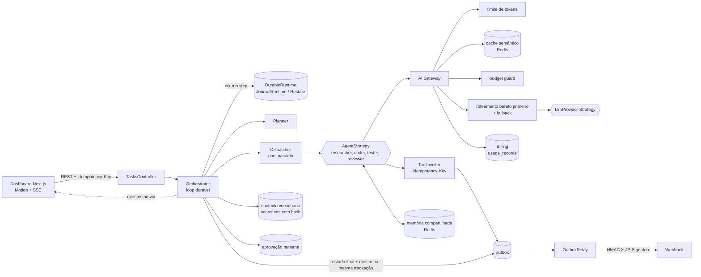

<div align="center">


# JP Orchestrator

**por JpDev**

Orquestrador open source de agentes de código: distribui tarefas entre subagentes em paralelo,
com AI Gateway, execução durável, memória compartilhada, contexto versionado e billing por tarefa.

NestJS · TypeScript · Postgres · Redis · Next.js · Motion · Docker Compose · MIT

</div>

---

## Português

### O que é

O JP Orchestrator recebe uma tarefa de engenharia ("criar endpoint REST com testes"), quebra em
subtarefas, roda subagentes especializados em paralelo (pesquisador, coder, tester, revisor),
consolida o resultado e publica um evento assinado quando termina. Cada chamada de modelo passa
por um AI Gateway que prioriza cache e modelos baratos, registra tokens e custo, e corta a tarefa
automaticamente quando o orçamento estoura.

Nesta versão os subagentes usam um provedor de modelo determinístico (`MockProvider`) com latência
configurável. A interface `LlmProvider` é uma Strategy: um provedor real entra como mais uma classe,
sem mexer no orquestrador.

O dashboard em Next.js mostra tudo ao vivo via SSE: subagentes rodando em paralelo, fluxo pelo
gateway (cache, modelo, fallback), custos animados, timeline do contexto versionado, aprovação
humana e webhooks recebidos com assinatura verificada.


### Arquitetura



### Patterns e onde estão no código

| Pattern | O que faz | Onde |
|---|---|---|
| AI Gateway | Ponto único das chamadas de modelo: limite de tokens, cache semântico, budget guard, roteamento pelo modelo mais barato do tier, fallback em queda | `api/src/gateway/gateway.service.ts`, `model-catalog.ts`, `semantic-cache.ts` |
| Strategy | Registro por eixo (`StrategyRegistry`), mesmo estilo do strategy-pattern-checkout: agentes, provedores de modelo e ferramentas | `api/src/strategy/strategy-registry.ts`, `agents/agents.ts`, `gateway/llm-provider.ts`, `tools/builtin-tools.ts` |
| Durable execution | Loop escrito como passos nomeados (`ctx.run`); passo concluído nunca roda de novo; retoma após crash ou pausa. Interface pronta para Restate | `api/src/durable/durable-runtime.ts`, `journal.runtime.ts`, `restate.runtime.ts` |
| Idempotency-Key + outbox | `POST /tasks` com `Idempotency-Key`; ferramentas executam uma vez por chave e gravam o evento na mesma transação do resultado | `api/src/tools/tool-invoker.service.ts`, `persistence/pg.store.ts` |
| Aprovação humana durável | Pausa gravada no Postgres; aprovar ou rejeitar retoma o loop pelo journal, mesmo após restart | `api/src/approval/approval.service.ts`, `orchestration/orchestrator.service.ts` |
| Eventos assinados | Webhook com `X-JP-Signature: t=..,v1=HMAC-SHA256`, tolerância de replay, retry com backoff, entrega pelo outbox | `api/src/events/signer.ts`, `outbox-relay.service.ts`, `events.module.ts` |
| Memória compartilhada | Blackboard por tarefa (hash Redis): pesquisador publica, coder e revisor leem | `api/src/memory/shared-memory.ts` |
| Contexto versionado | Snapshots append-only com versão e hash encadeado (`hash = sha256(parentHash + JSON canônico)`), verificação de adulteração | `api/src/memory/context-store.service.ts` |
| Billing e orçamento | Tokens e custo por tarefa, subagente e modelo; corte automático ao estourar; relatório CSV | `api/src/billing/billing.service.ts`, `scripts/` |

### Loops de orquestração

Todo loop é limitado. Nada repete "até passar". Limites configuráveis por variável de ambiente.

| Loop | Objetivo | Critério de saída | Timeout | Limite de chamadas |
|---|---|---|---|---|
| task | Levar a tarefa a um estado final | completed, failed, rejected ou budget_exceeded (um único evento terminal) | `TASK_TIMEOUT_MS` (180 s), que aborta o loop via `AbortSignal` | 1 execução por vez por tarefa, entre réplicas (lease `TASK_LEASE_MS`) |
| plan | Quebrar a tarefa em subtarefas | pelo menos 1 subtarefa de trabalho e 1 revisor | `PLAN_TIMEOUT_MS` (15 s) | 1 chamada ao gateway (tier barato) |
| dispatch | Rodar subagentes de cada onda em paralelo (`MAX_PARALLEL`) | todas as subtarefas em done | `SUBAGENT_TIMEOUT_MS` (30 s) por subagente | 2 por subtarefa (1 retry) |
| correction | Revisor aprova ou devolve feedback; coders corrigem | revisão aprovada; falha após 2 rodadas | `REVIEW_TIMEOUT_MS` (30 s) | máximo 2 rodadas de correção |
| approval | Pausa durável até decisão humana | approved ou rejected | sem timeout (pausa persistida) | 0 chamadas de modelo |
| merge | Consolidar saídas e artefatos | resultado único sem duplicatas | `MERGE_TIMEOUT_MS` (10 s) | 0 chamadas de modelo |
| outbox | Entregar eventos assinados | 2xx, ou morto após `OUTBOX_MAX_ATTEMPTS`, ou `expired` após `OUTBOX_MAX_AGE_MS` | `OUTBOX_TIMEOUT_MS` (5 s) por entrega | 5 tentativas, backoff 2^n s, idade máxima 10 min |

Ondas do dispatch: pesquisadores primeiro (alimentam a memória compartilhada), depois coders e
testers em paralelo, depois o revisor.

### Economia de tokens

- Cache semântico antes de qualquer chamada: prompt parecido (cosseno >= `CACHE_SIMILARITY`) custa zero e registra a economia.
  O escopo é `tenant:tarefa:agente:tier`: uma resposta nunca é servida para outra tarefa ou outro tenant.
- Roteamento pelo modelo mais barato do tier pedido; tiers mais caros só como fallback.
- Limite de tokens de entrada e saída antes de gastar.
- Budget guard por tarefa com reserva atômica: antes de cada chamada (e de cada fallback) o custo estimado é reservado
  só se `gasto + reservado + estimativa <= orçamento`; depois a reserva é liquidada pelo custo real. Subagentes em
  paralelo não estouram o orçamento. A chamada que cruzaria o limite é bloqueada e a tarefa vai para `budget_exceeded`.
- Embedding local (hash de palavras e bigramas): a consulta ao cache não chama modelo.

### Segurança e acesso

- **API key obrigatória** (`API_KEY`, mínimo 32 caracteres; a API não sobe sem ela). Toda rota exige o header
  `x-api-key: <chave>` ou `Authorization: Bearer <chave>`. O SSE `GET /events` também aceita `?api_key=<chave>`,
  porque o `EventSource` do navegador não envia headers. Rotas públicas: `GET /health` (healthcheck) e
  `POST /webhooks/inbox` (autenticado pela assinatura HMAC).
- **Rate limit por IP** (janela fixa em memória, antes da checagem da chave): `RATE_LIMIT_MAX` (1800) requisições
  por `RATE_LIMIT_WINDOW_MS` (60 s) em todas as rotas e `RATE_LIMIT_TASKS_MAX` (20) para `POST /tasks`. Excedeu:
  `429` com `Retry-After`. Cada réplica conta sozinha; para limite global, use um proxy ou gateway na frente.
- **Bind**: `HOST`, padrão `127.0.0.1`. A imagem Docker define `HOST=0.0.0.0` e o compose publica API e web só em
  `127.0.0.1` do host.
- **CORS** com allowlist fechada: `CORS_ORIGIN` (lista separada por vírgula). Fora de produção o padrão é
  `http://localhost:3000,http://127.0.0.1:3000`; em produção a variável é obrigatória e `*` não é aceito.
- **Segredo HMAC dos webhooks** (`WEBHOOK_SECRET`): em produção o boot falha se estiver ausente, igual ao antigo valor
  de exemplo ou com menos de 32 caracteres. Fora de produção, nesses casos, a API usa um segredo aleatório por
  processo (com aviso) e nunca assina com o valor público.
- **Dashboard**: o web envia a chave em todo `fetch`, no download do CSV e no SSE, lida de `NEXT_PUBLIC_API_KEY` no
  build. Variável `NEXT_PUBLIC_*` vai embutida no JavaScript do navegador: quem abre o dashboard consegue ler a
  chave. Isso serve para a demo local; não exponha o dashboard fora da sua máquina sem um login próprio na frente.

### Garantias de entrega

- **Webhooks (outbox → receptor): at-least-once + dedupe no receptor.** O evento nasce na mesma transação do
  estado que o gerou. O `OutboxRelay` reivindica o evento com um lease de 30 s (`OUTBOX_CLAIM_LEASE_MS`, `FOR UPDATE SKIP LOCKED`) e só
  marca `delivered` depois do 2xx. Se o processo morrer entre o 2xx e essa marca, ou a entrega passar de 30 s, o
  evento é reenviado. Todo envio do mesmo evento leva os mesmos `X-JP-Event-Id` e `Idempotency-Key` (= id do
  evento), com assinatura nova. O receptor deduplica por esse id: `webhook_inbox.event_id` é `UNIQUE` e o insert
  usa `ON CONFLICT DO NOTHING`; a repetição responde 200 com `duplicate: true`. Só deduplica evento com assinatura
  válida e cujo header bate com o `id` assinado no corpo, para uma requisição forjada não "ocupar" o id de um evento real.
- **Ferramentas (`ToolInvoker`): no máximo um resultado por `Idempotency-Key`; efeito externo idempotente pela chave.**
  Antes de executar, grava a linha `started` com lease (`TOOL_LEASE_MS`, padrão 10 s, menor que o timeout de 30 s do
  subagente). O handler recebe `ctx.idempotencyKey` (estável entre tentativas) e `ctx.attempt`, e tem o lease como
  timeout. Resultado e evento `tool.executed` são gravados na mesma transação, protegidos pelo número da tentativa
  (fencing). Se o processo morrer entre o efeito e o commit, a nova tentativa (inclusive a retomada no boot) espera o
  lease vencer, no máximo um lease, e reconcilia rodando o handler de novo com a mesma chave. Por isso, ferramenta com
  efeito externo **precisa** repassar `ctx.idempotencyKey` ao sistema de destino: o handler pode rodar mais de uma vez,
  e é o destino que aplica o efeito uma vez só. Sem isso não existe exactly-once.
- **Horizonte de retry dentro do TTL da chave (verificado no boot).** O receptor e o destino só deduplicam enquanto
  lembram da chave (`IDEMPOTENCY_KEY_TTL_MS`, padrão 24 h). Uma reentrega depois disso aplicaria o efeito de novo, então:
  - o relay marca `dead` com `last_error = 'expired'`, sem enviar, todo evento mais antigo que `OUTBOX_MAX_AGE_MS`
    (padrão 10 min), checado antes de cada envio;
  - o `ToolInvoker` limita os takeovers de lease a `TOOL_MAX_ATTEMPTS` (padrão 3) e recusa reexecutar uma chamada
    `started` criada há mais de `IDEMPOTENCY_KEY_TTL_MS`; nos dois casos lança `ToolCallRefusedError` sem rodar o handler;
  - o boot falha (`assertRetryHorizon`, `api/src/common/retry-horizon.ts`) se o pior caso do outbox
    (soma dos backoffs + tentativas × (`OUTBOX_TIMEOUT_MS` + `OUTBOX_CLAIM_LEASE_MS`), 205 s no padrão), o das
    ferramentas (`TOOL_MAX_ATTEMPTS` × `TOOL_LEASE_MS`, 30 s) ou `OUTBOX_MAX_AGE_MS` for >= `IDEMPOTENCY_KEY_TTL_MS`,
    ou se algum desses valores não for inteiro positivo.
  Configure `IDEMPOTENCY_KEY_TTL_MS` com o menor TTL de chave entre os receptores e destinos reais. `webhook_inbox`
  e `tool_calls` ainda não são podados, então o receptor de demonstração lembra da chave para sempre.
- Os testes com `crash` no nome simulam a morte do processo nesses dois pontos (`outbox-relay.spec.ts`, `tool-invoker.spec.ts`).
- Migrações SQL em `api/src/persistence/migrations/`, aplicadas no boot uma vez cada (tabela `schema_migrations`).
  O SQL do `PgStore` e as migrações são testados num Postgres real em WASM (PGlite) em `pg.store.spec.ts`.
- Eventos gravados no inbox antes da v0.3.2 não têm `event_id`, então uma reentrega deles não é deduplicada.

### Como rodar

Pré-requisitos: Docker com Compose, Node 22.

```bash
cp .env.example .env                # preencha API_KEY, NEXT_PUBLIC_API_KEY (= API_KEY) e WEBHOOK_SECRET:
openssl rand -hex 32                #   um valor para API_KEY/NEXT_PUBLIC_API_KEY, outro para WEBHOOK_SECRET
docker compose up -d --build        # postgres, redis, api (127.0.0.1:3001), web (127.0.0.1:3000)
open http://localhost:3000

export API_KEY=...                  # os scripts e o e2e mandam essa chave em x-api-key
npm run loop:run                    # dispara um loop real e mostra o pico de subagentes em paralelo
npm run billing:report              # relatório de consumo em reports/billing-AAAA-MM-DD.md
npm run budget:check -- --warn 0.8  # sai com código 1 se alguma tarefa passou de 80% do orçamento
```

Desenvolvimento local:

```bash
npm run install:all
npm test                            # testes unitários (jest) da API
npm run prepush                     # lint + typecheck + build + testes
npx playwright install chromium && npm run e2e   # e2e contra o stack rodando
```

Sem `DATABASE_URL` e `REDIS_URL` a API roda inteira em memória. Variáveis em `.env.example`. Para rodar a API fora
do Docker, exporte `API_KEY` (e `NEXT_PUBLIC_API_KEY` com o mesmo valor ao subir o web).
Contrato da API em `docs/api-contract.md`. Screenshots do e2e em `docs/screenshots/`.

### Vídeos de demonstração

Gravados com Playwright sobre a stack real (`docker compose up`), sem mocks, e montados com ffmpeg:
`docs/marketing/tiktok-instagram-9x16.mp4`, `docs/marketing/linkedin-1x1.mp4` e `docs/marketing/linkedin-16x9.mp4`.

```bash
node scripts/marketing/record.mjs desktop reports/marketing   # 1600x900, com marcadores de tempo
node scripts/marketing/record.mjs mobile reports/marketing    # 720x1280
node scripts/marketing/build-videos.mjs reports/marketing docs/marketing
```

O ffmpeg do Homebrew não tem `drawtext` nem `libass`: legendas e cartões da marca são PNG renderizados pelo Playwright e aplicados com `overlay`.

### Identidade visual (JpDev)

| Token | Valor | Uso |
|---|---|---|
| `brand` | `#FFC800` | CTA principal, destaques, foco visível, rótulos de seção |
| `brand-soft` | `#FACC15` | hover do CTA, status "Planejando" |
| `ink` | `#0A0A0A` | fundo e texto sobre amarelo (contraste 12,7:1 com o amarelo) |
| `accent` | `#FF7A00` | apoio: aguardando aprovação, integrando, barras por agente |
| `ok` / `bad` | `#5FBF85` / `#F07171` | só status semântico (sucesso / falha) |

Tipografia: Space Grotesk (títulos, via `next/font`) e Inter (texto). O logo é `brand/jpdev-logo.png`,
apenas redimensionado para o topbar (`web/public/jpdev-logo.png`), favicon (`web/app/icon.png`, `apple-icon.png`),
este README e os vídeos. Os vídeos carregam as fontes do Google Fonts no render e o build falha se elas não carregarem.

### Inspiração

O desenho de portões, loops limitados e "teste verde manda" é inspirado conceitualmente no
[VJP Harness](https://github.com/Joao-Pedro-AI-Visionary/vjp-harness). Não há dependência de código.

---

## English

### What it is

JP Orchestrator is an open source orchestrator for coding agents. It splits an engineering task into
subtasks, runs specialized subagents in parallel (researcher, coder, tester, reviewer), merges their
output and emits an HMAC-signed event when done. Every model call goes through an AI Gateway with
token limits, a semantic cache, cheapest-first routing, model fallback and a per-task budget with an
automatic cut. The agent loop is durable (journaled steps, Restate-ready interface), tool calls are
idempotent with a transactional outbox, human approval is a durable pause, subagents share a per-task
memory and the task context is versioned as hash-chained snapshots. A Next.js dashboard shows it all
live over SSE.

This version ships a deterministic `MockProvider`; real providers plug in as another `LlmProvider` strategy.

### Security and access

- **API key required** (`API_KEY`, at least 32 chars; the API does not boot without it). Every route needs
  `x-api-key: <key>` or `Authorization: Bearer <key>`. The SSE stream `GET /events` also accepts `?api_key=<key>`
  (browser `EventSource` cannot send headers). Public routes: `GET /health` and `POST /webhooks/inbox` (HMAC-signed).
- **Per-IP rate limit** (in-memory fixed window, checked before the key): `RATE_LIMIT_MAX` (1800) per
  `RATE_LIMIT_WINDOW_MS` (60s) on every route, `RATE_LIMIT_TASKS_MAX` (20) on `POST /tasks`; `429` + `Retry-After`.
- **Bind** on `HOST`, default `127.0.0.1`; the Docker image sets `0.0.0.0` and compose publishes on host loopback only.
- **CORS** allowlist from `CORS_ORIGIN` (comma separated). Required in production, `*` rejected.
- **Webhook HMAC secret**: in production the boot fails when `WEBHOOK_SECRET` is missing, equal to the old example
  value or shorter than 32 chars. Outside production a random per-process secret is used instead, with a warning.
- **Dashboard** sends the key from `NEXT_PUBLIC_API_KEY` (build time). It ends up in the browser bundle, so this is
  for local demos only; do not expose the dashboard without your own login in front of it.

### Delivery guarantees

- **Webhooks (outbox → receiver): at-least-once delivery + receiver dedupe.** Events are written in the same
  transaction as the state change. The relay claims an event with a 30s lease (`OUTBOX_CLAIM_LEASE_MS`) and marks it `delivered` only after a
  2xx, so a crash between the 2xx and the mark (or a delivery slower than the lease) resends it. Every send of one
  event carries the same `X-JP-Event-Id` and `Idempotency-Key` (the event id). Receivers must dedupe on it; the demo
  receiver does so with a `UNIQUE` `webhook_inbox.event_id` and `ON CONFLICT DO NOTHING`, answering 200 with
  `duplicate: true` on a replay (only for verified events whose header matches the signed body id).
- **Tool calls: one stored result per `Idempotency-Key`; external effects idempotent on that key.** A `started` row
  with a lease (`TOOL_LEASE_MS`, default 10s, below the 30s subagent timeout) is persisted before the handler runs;
  handlers get `ctx.idempotencyKey` and `ctx.attempt` and are bounded by the lease; the result and its outbox event
  commit together, fenced by the attempt. After a crash between the effect and the commit, the retry (including the
  boot resume) waits up to one lease, then re-runs the handler with the same key. The handler may run more than
  once, so tools with external side effects must forward `ctx.idempotencyKey` and let the downstream apply it once.
- **Retry horizon inside the key TTL (checked at boot).** Receivers and downstreams only dedupe while they remember
  the key (`IDEMPOTENCY_KEY_TTL_MS`, default 24h). The relay marks events older than `OUTBOX_MAX_AGE_MS` (default
  10 min) `dead` with `last_error = 'expired'` without sending them; the `ToolInvoker` caps lease takeovers at
  `TOOL_MAX_ATTEMPTS` (default 3) and refuses to re-run a `started` call created more than the key TTL ago
  (`ToolCallRefusedError`, handler not run). Startup fails (`assertRetryHorizon`) if the outbox worst case (sum of
  backoffs + attempts × (`OUTBOX_TIMEOUT_MS` + `OUTBOX_CLAIM_LEASE_MS`), 205s by default), the tool worst case
  (`TOOL_MAX_ATTEMPTS` × `TOOL_LEASE_MS`, 30s) or `OUTBOX_MAX_AGE_MS` is >= the key TTL. Set the TTL to the smallest
  key retention among your real receivers and downstreams.
- Tests with `crash` in their name kill the process at both points; they assert the same ids/key are reused and
  that a receiver or downstream honoring the key applies the effect once.

### Run it

```bash
cp .env.example .env           # fill API_KEY, NEXT_PUBLIC_API_KEY (= API_KEY), WEBHOOK_SECRET (openssl rand -hex 32)
docker compose up -d --build   # http://localhost:3000 (UI), http://localhost:3001 (API)
export API_KEY=...             # scripts and e2e send it as x-api-key
npm run loop:run               # real orchestration loop with parallel subagents
npm run billing:report         # token and cost report
npm test                       # unit tests
npm run e2e                    # Playwright e2e against the running stack
```

See the pattern table and the loop table above for where each pattern lives in the code.

Demo videos (recorded with Playwright on the real stack, edited with ffmpeg) live in `docs/marketing/`;
`scripts/marketing/record.mjs` and `scripts/marketing/build-videos.mjs` rebuild them.

Brand: JpDev logo (`brand/jpdev-logo.png`, resized only), yellow `#FFC800` and black `#0A0A0A` with orange `#FF7A00`
as support, Space Grotesk for headings and Inter for body text.

### License

MIT, by JpDev.
